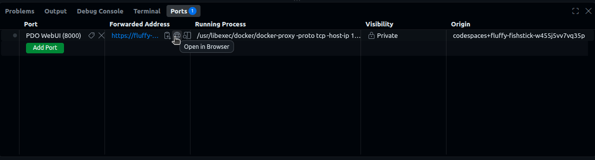

# End-to-End Tutorial: A Policy-Gated Dataset Example

This tutorial walks you through the **entire flow using a web UI**. By the end of this tutorial, a **Dataset User** downloads a dataset from a **Guardian**. Specifically, the **Guardian** protects access to the dataset published by a **Dataset Owner**. The **Dataset Owner** has registered specific policies (i.e., rules) for downloading the dataset.  The **Dataset User** is able to perform the specific operation (i.e., download dataset) only when they present valid credentials (i.e., issued by authorities the owner accepts) and satisfy the **Dataset Owner's** policies.

---

## The story

A research institution publishes a medical dataset but aims to share it only with individuals that meet specific **policies**. Rather than vetting each requester manually every time, the institution registers the **policies** to their dataset and lets the Policy Fabric enforce them automatically.

Three personas participate in this tutorial:

- A **Trusted Issuer** who can provide digital credentials (e.g., university registrar, identity provider, government, etc.).
- A **Dataset Owner** who publishes the dataset behind those policies (e.g., research institution, data broker, etc.).
- A **Dataset User** who wants to download the dataset (e.g., researcher, student, company, etc.)
  
### The policies for the dataset

In this tutorial the **Dataset Owner** attaches the following **two policies** to the dataset. **Both** must hold for a **Dataset User** to download the dataset:

1. **The Dataset User must reside in a specific country (i.e., geographic rule):** the user's physical residence address must be in an **allowed country** — in this tutorial it is **US**.
2. **The Dataset User must be affiliated with a specific organization (i.e, institution rule):** the requester must belong to an **allowed institution** — in this tutorial it is **`did:example:best_university`**.

### What you'll do in this tutorial

1. The **Trusted Issuer** creates two **authorities**. The first is a *hand-signing* authority, a registry office that attests where people are and which institution they belong to; it signs two credentials for the Dataset User — one saying the user resides in the US, one saying they belong to `did:example:best_university`. The second is a *system* authority for session keys: it issues the **Dataset User** a session key the moment they actually request the data, so the data can be sent back to them securely. **Important**: the signed credentials alone don't unlock access to the dataset. The policy protecting the dataset unlocks it only if the credentials contain suitable claims AND are signed by an authority the Dataset Owner accepts.
2. The **Dataset Owner** publishes the dataset — starts a **Guardian** that holds it, picks the two policies, and, for each fact the policies read, chooses which authority to accept.
3. The **Dataset User** requests the dataset. A checklist first shows what they hold and what will be obtained on the way. The session key is obtained automatically, the policies are checked by the Policy Engine, and the file comes back encrypted for their session key and is decrypted for them on screen.

---

## 3 Personas

Everything runs against a single client identity at a time. This means you change roles by switching the identity in the navbar. The 3 roles are:

| Role | What they do |
| ------ | -------------- |
| **`vc_issuer`** | is the **Trusted Issuer**. They create two authorities: one hand-signs location and affiliation credentials for the **Dataset User**, and one issues session keys automatically when the user later downloads data. |
| **`data_owner`** | is the **Dataset Owner**. They publish the dataset behind a guardian and a set of policies, and decide which authorities to accept. |
| **`data_user`** | is the **Dataset User**. They present their credentials, and if the policies are satisfied, download and decrypt the dataset. |

> **🔁 "Switch identity" callout** — Whenever you see this, use the **Identity dropdown at the top-right of the navbar** and pick the username. The page reloads as that identity and returns you to the home page.

!!! note "Useful terminologies"

    - **Wallet** — your personal container for credentials. It has a unique id (a **DID**) like `did:pdo:…`.
    - **Fact** — what a policy needs to know about the requester, such as their *location* or *affiliation*. A fact arrives as a signed **credential**.
    - **Authority** — whoever establishes a fact. You create one on the **Authorities** page. There are three kinds:
        - **Hand-signing** — a person or office signs a credential after its own review, by clicking **Sign Credential**.
        - **Rule-based** — a locked rule issues the fact from other facts (see the [ethics approval tutorial](tutorial_irb.md)).
        - **System** — establishes facts the system itself can check, such as a session key bound to a wallet. Nobody signs anything by hand: the app calls on it when a requester needs one.
    - **Session key** — an RSA key pair the app generates for the user, through a session-key authority, the first time it's needed for a download. Data is encrypted to the **public** half; only the matching **private** half (kept locally) can open it.
    - **Guardian** — a service that holds the actual data file and hands it out (encrypted) only once a request has been approved.
    - **Policy** — the owner's rules, enforced automatically. When a user asks for the data, the policy checks their credentials and, if they qualify, approves the download.

---

## Part 0 — Start the Demo App

### Running in cloud via GitHub Codespaces

You can launch a preinstalled [Codespace](https://github.com/features/codespaces) cloud environment by clicking this button:

[](https://codespaces.new/mlcommons/policy_fabric?ref=main){ target="_blank" rel="noopener" }

The devcontainer automatically brings up the policy engine, registries, and the webapp, and creates the tutorial data file for you. The first start pulls several images, so give it a few minutes — progress shows in the Codespaces log.

When it finishes, click the forwarded **port 8000** (in the **Ports** tab) to open the webapp. Hover the forwarded address and click the globe icon to open it in a browser. Then follow the steps below.



---

## Part 1 — Dataset User extracts wallet DID

We start with the **Dataset User** because the **VC Issuer** (Part 2) needs the **Dataset User's wallet DID** (i.e., the identity of the user the credentials belong to) before it can issue anything for them.

> **🔁 Switch identity to `data_user`.**

### 1.1 Copy your wallet's DID

1. Go to **Wallets** (navbar) → click **Open** on your wallet.
2. Under **Wallet Info**, click **Copy** next to the **DID**.

> 📋 **Keep this as `USER_DID` in your notes.** The issuer signs every credential *about* this DID.

*What's happening in the background:* the **wallet** is the user's identity on the policy engine and the place their credentials will live.

---

## Part 2 — VC Issuer creates authorities and issues the user's credentials

You'll create two authorities here: a **hand-signing** one, which signs two credentials about `data_user`, and a **system** one for session keys, which you set up once and otherwise leave alone — the app calls on it automatically later, in Part 4.

> **🔁 Switch identity to `vc_issuer`.**

### 2.1 Create a hand-signing authority

1. Go to **Authorities** (navbar) → **+ Create Authority**.
2. **Name:** `University registry`. **Kind:** **Hand-signing**.
3. Under **Facts it attests**, check **Location** and **Affiliation**.
4. **What it checks:** `Checks enrolment records before signing.` → **Create**.

*What's happening:* a **wallet** stores credentials; an **authority** holds signing keys, so anything it signs can be traced back to it and checked. Creating it also lists it in the **directory**, with the facts it attests, so that a Dataset Owner can find it by name and accept it — nobody has to pass DIDs around.

### 2.2 Create a session-key authority

1. Still on **Authorities** → **+ Create Authority**.
2. **Name:** `Session keys`. **Kind:** **System**. → **Create**.

*What's happening in the background:* this creates the session-key authority and the *wallet key* authority it rests on. Neither signs anything by hand. When a requester at an asset that accepts it needs a session key (Part 4), the app asks it for one: it binds a fresh key to the requester's wallet — once the wallet's own ledger key signs for it — and issues a `publicKeyCredential` for it.

### 2.3 Issue the **Location** credential

1. Open `University registry` and click **Sign Credential**.
2. Fill the modal:
   - **Fact:** `Location`
   - **About:** the `USER_DID` from your notes (step 1.1)
   - **Deliver to wallet:** the same `USER_DID` — the credential goes to the wallet it is about
   - **Claims:** Street `1 Main`, Zip code `00000`, State `MA`, Country `US`
3. Click **Sign & Deliver** — the credential is signed and stored in the Dataset User's wallet.

*What's happening in the background:* the claims form is generated from the fact's JSON Schema, and the claims are checked against it before anything is signed. You, as the registry office, signed a verifiable statement saying that `data_user` (identified by their DID) is located in the US.

### 2.4 Issue the **Affiliation** credential

1. On `University registry` → **Sign Credential**.
2. Fill:
   - **Fact:** `Affiliation`
   - **About:** the `USER_DID` from your notes
   - **Deliver to wallet:** the same `USER_DID`
   - **Claims:** Is member of `did:example:best_university`, Type of membership `member`
3. **Sign & Deliver**.

Both credentials are now in `data_user`'s wallet. (Switch to `data_user` and open the wallet to see them under **Stored Credentials**, with who signed them.)

**Important**: the signed credentials alone don't unlock access to the dataset. The policy protecting the dataset unlocks it only if the credentials contain suitable claims AND are signed by an authority the Dataset Owner accepts. You will set that up next, as the Dataset Owner.

---

## Part 3 — Dataset Owner publishes dataset behind policies

Now the **Dataset Owner** stands up a guardian for storing the dataset, and registers the policies 

> **🔁 Switch identity to `data_owner`.**

### 3.0 Dataset file

For the tutorial's sake, the dataset is a single small file. **It is already created for you at `/tmp/asset_data.txt`** — you don't need to create anything.

### 3.1 Register the asset (and start its guardian)

1. Go to **Assets** (navbar) → **+ Register Asset**.
2. **Name:** `data1`. **Data Path:** `/tmp/asset_data.txt` → **Register Asset**.
3. Registration takes a few seconds — the app is also starting a **guardian** for the data and waiting for it to come up.

*What's happening:* registering the asset also starts a **guardian** that serves `/tmp/asset_data.txt`. Open `data1` and you'll see *"Your asset is behind the guardian running on http://‹host›:‹port›."* The asset still needs a policy before anyone can use it — that's next.

### 3.2 Expose the asset

Still on `data1`, the **Expose** panel lists the policies that fit this asset's guardian.

1. **Policies:** check **GS · Geographical restriction** and **IS · Institution-specific restriction**. (Use **View** to read a policy card and its rule.) The panel also notes the delivery module every download asset gets: it releases the data encrypted to the requester's **session key**.
2. **Parameters:** each policy gets its own form.
      - **GS → Allowed countries:** `US`
      - **IS → Allowed institutions:** `did:example:best_university`
3. **Accepted authorities:** one row per fact the policies read.
      - **Location:** check **University registry**.
      - **Affiliation:** check **University registry**.
      - **Session key:** **Session keys** is already checked — it is the only authority in the directory that establishes it.
4. **Review** reads: *Requesters will need: Location (University registry), Affiliation (University registry), Session key (automatic).* Click **Expose**.

*What's happening:* this creates the asset's **policy**: the two policies and the delivery module, each with its own parameters, and the authorities it accepts **for each fact**. The geographic rule checks a location in an allowed country, the institution rule checks membership in an allowed institution, and both read facts about the **same wallet** that presents them. A credential signed by an authority you did not accept counts for nothing here, and if you had allowed a different country, the policy would deny `data_user`, whose credential says `US`.

The asset is now fully published: dataset behind a guardian, gated by a policy that accepts both authorities. Its page now lists the policies, the accepted authorities by name and kind — with **Remove** to withdraw trust and **Accept** to add more — and each policy's parameters.

---

## Part 4 — Dataset User downloads the dataset

Finally, the **Dataset User** requests to download the dataset.

> **🔁 Switch identity to `data_user`.**

1. Go to **Assets**. The `data1` card shows an enabled **Use** button.
2. Click **Use** → in the modal, select **your wallet** for the **User** role.
3. The checklist fills in:
      - **Location — Held**, **Affiliation — Held**: in your wallet, from an authority this asset accepts.
      - **Session key — Automatic**: obtained on the way, from `Session keys`.
4. Click **Request Download**. After a moment, the data appears:

   ```text
   The eagle lands at midnight.
   ```

*What's happening in the background* (the whole handshake, end to end):

1. The checklist is built from public data only: the policy's requirements, the authorities it accepts, the directory, and your wallet. **Request Download** is enabled only once every fact is held or automatic; anything else names the authority to ask.
2. The app gets the automatic facts first: it asks `Session keys` for a session key, which lands in your wallet as a `publicKeyCredential`.
3. The app presents your wallet's credentials about you, and names the session key the data should be encrypted to.
4. The **policy** checks that each credential is signed by an authority it accepts for that fact and that both policies pass — and since the same person satisfies both, it **approves** the request and issues a capability package naming your session key.
5. That capability package goes to the **guardian**, which encrypts the file to your session key and returns it.
6. The app decrypts it with your **private** session key and shows you the data.

---

## End of Tutorial: What you just built

```text
University registry  ──signs──►   Location · Affiliation
   (hand-signing)                  │
Session keys         ──issues──►  Session key        (at download time)
   (system)                        │ stored in
                                   ▼
                                   data_user's wallet
                                   │ presents
                                   ▼
                                   Policy (GS + IS + download delivery)
                                   │ accepts each authority for its facts
                                   │ checks the policies
                                   ▼
                               capability ──────────►  guardian
                                                        │ encrypts the file to
                                                        │ data_user's session key
                                                        ▼
data_user  ◄── decrypt with private session key ──  encrypted file
```

IMPORTANT: The **Dataset Owner** never saw the **Dataset User's** credentials, the **Guardian** never evaluated the policies, and the dataset was downloaded from the **Guardian** encrypted to a key only the compliant **Dataset User** holds.

---
