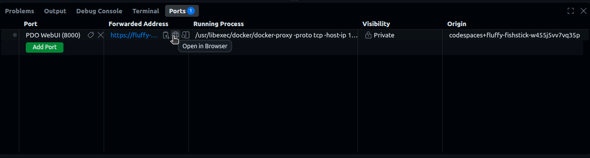

# End-to-End Tutorial: Federated, Policy-Gated Inference

This tutorial walks you through the **entire flow using a web UI**. By the end, a **Script Owner** runs one piece of code across **two hospitals at once** and never sees either of their datasets. Neither dataset leaves the hospital's own **FL client** that holds it; the code travels to the data instead, the hospital's **Guardian** decides whether it may run, and only aggregate numbers come back. Each hospital has independently decided what it will allow, and the two have decided differently.

If you have not done the [download tutorial](tutorial.md) yet, do that one first. It introduces wallets, authorities, credentials and policies with a simpler flow. This tutorial assumes those terms.

---

## The story

Two hospitals each hold a patient cohort neither is willing to hand out to anyone, under any policy. Copies cannot be recalled. But each is willing to let approved code run *inside its own environment* and release aggregate results.

That is the shape of federated learning, and it changes the question a policy has to answer. A download policy asks **who is asking**. An inference policy also has to ask **what is going to run**, because approving a requester says nothing about the code they bring. And when there are two hospitals rather than one, a third thing follows: there is no central authority to ask. Each site answers the same request separately, with whatever policies it chose.

Four personas participate:

- A **Trusted Issuer** who vouches for code and for people (e.g., a data access committee, a code review board).
- **Two Dataset Owners** — Hospital A and Hospital B — who each publish their own cohort behind their own policies.
- A **Script Owner** who wants to run their analysis against both (e.g., a researcher).

### The two policies

| Policy | The question it answers | Who attaches it |
| --- | --- | --- |
| **FL-DS** — disease-specific inference | *what is this code for?* | Hospital A, and Hospital B |
| **FL-IS** — institution-specific inference | *who is running it, and do they stand behind it?* | Hospital B only |

**Hospital A** is satisfied by a rule about the code. **Hospital B** wants that *and* a rule about the requester, so it attaches **both**. Every inference asset also gets the guardian's **delivery module**, which names what the capability allows: *run the script identified by this digest*. The contract asks every module, the request is allowed only if **all** of them allow it, and the requester has to satisfy the union of the facts they read.

So a single request is judged by two modules at Hospital A and three at Hospital B.

### What each module reads

The facts are about two identities: the **Script**, presented from the script asset, and the **User**, presented from the requester's wallet.

| Module | Role | Fact | What it says |
| --- | --- | --- | --- |
| FL-DS | **Script** | Intended data use | the diseases this code is declared for, which must overlap the owner's **allowed diseases** — here **`MONDO:0005148`** (type 2 diabetes mellitus) |
| delivery | **Script** | Script digest | the digest identifying this code |
| FL-IS | **User** | Affiliation | which institution the requester belongs to |
| FL-IS | **User** | Wallet key | which key the requester's wallet is registered with on the ledger |
| FL-IS | **Script** | Script ownership | a wallet's claim that the script is **its** script |

The digest is what makes the declaration mean anything. The request names the digest of the script actually being sent, and the delivery module approves that digest only if an accepted authority signed it for this script. Without it, an in-scope declaration attached to one script could be presented alongside a completely different piece of code.

The ownership claim is the interesting one: it is *self-asserted*, signed by the requester's **own wallet**. On its own, "this script is mine" is worth nothing: anyone can say it about anything. It becomes evidence because FL-IS checks that signature against the key in the Wallet key credential, which *is* from an authority. So the chain is: an authority says *this wallet holds this key*, the wallet uses that key to say *this script is mine*, and another authority says *this wallet belongs to that institution*. All three must be about one wallet, and the ownership claim must be about the script being run.

---

## The Cast: 4 Roles

Everything runs against a single client identity at a time. You change roles by switching the identity in the navbar.

| Role | What they do |
| ------ | -------------- |
| **`data_user`** | is the **Script Owner**. They publish the script as an asset, get a **wallet**, claim the script with it, and later ask for the run. |
| **`vc_issuer`** | is the **Trusted Issuer**. They create a hand-signing authority that signs the credentials about the script and about the requester, and a system authority that attests wallet keys. |
| **`hospital_a`** | is the first **Dataset Owner**. Cohort behind an inference guardian, FL-DS attached. |
| **`hospital_b`** | is the second **Dataset Owner**. Own cohort, own guardian, and **both** policies. |

> **🔁 "Switch identity" callout** — Whenever you see this, use the **Identity dropdown at the top-right of the navbar** and pick the username. The page reloads as that identity and returns you to the home page.

!!! note "Useful terminologies"

    - **Guardian** — the service standing in front of an asset. This tutorial uses two kinds:
        - **Public** — hands the file to anyone who asks, with no policy at all. The script lives behind one of these, because the whole point of a script is that everyone can read the code being judged.
        - **Inference** — holds no data at all. The dataset is mounted into the **FL client** that runs beside it; the guardian only answers that client **yes or no**: may the script it was sent run? It says yes only against a capability naming the digest of exactly that code.
    - **Script asset** — a script registered as an asset. It has its own identity (a DID), and the credentials *about the code* live on it, exactly as a person's credentials live in their wallet. Its DID is also how the runner finds the public guardian to fetch the code from — one identity settles both.
    - **Digest** — `sha256:<hex>` over the script's bytes. The policy approves a digest; every FL client re-computes it from the code it actually holds.
    - **FL server** — the job board every site connects to. It knows nothing about PDO. It keeps which FL client holds which asset DID; a requester submits a **round** to it, and it hands each site's capability to the client holding that site's DID.
    - **FL client** — runs next to a guardian, inside one data holder's environment, and **holds that data holder's dataset**. It joins the FL server under its own **FL client ID**, together with the DID of the asset it holds. It is the party that turns a *claim* about code into a *fact* about code: it hashes the script it received and asks its guardian before running it.
    - **Site** — one dataset, held by one FL client, with one inference guardian deciding what may run over it.
    - **Round** — one script, several sites, one submission.

### How the FL server knows whose capability is whose

This is the one piece of plumbing worth understanding before you start, because it is what makes a round over several sites possible at all.

A capability is minted by **one** asset's policies, for **one** guardian, and is refused at every other guardian. So when the webapp hands an FL server several capabilities at once, the server cannot simply give them out to whoever asks first — nearly every such handout would be a site receiving a capability its guardian will refuse.

The answer is two IDs per site, and a mapping between them. Each FL client joins the FL server under its own **FL client ID** — the webapp names it after the guardian's address, `host:port` — and says which asset it holds by that asset's **DID**. The server keeps the pair in memory: one client per DID, one DID per client.

```text
FL client beside A's guardian ──► joins as { client_id: host:7900, asset_did: A }
FL client beside B's guardian ──► joins as { client_id: host:7902, asset_did: B }
   │
   ▼
FL server keeps the mapping:  A ──► host:7900
                              B ──► host:7902
   │
   ▼ GET /clients
Federated tab resolves each DID through the asset registry (A is hospital_a_cohort, …)
   │
   ▼
you pick sites; each one's own policy mints its capability
   │
   ▼
round submitted: [ { asset_did: A, capability: cap_A },
                   { asset_did: B, capability: cap_B } ]
   │
   ▼
FL server matches each DID to its client:  cap_A ──► a job for host:7900
                                           cap_B ──► a job for host:7902
   │
   ▼
host:7900 claims its job and only that one; so does host:7902
```

The webapp names every capability by its asset's DID and never by FL client: which client holds which DID is the FL server's to know, from what the clients told it. That is why the asset's DID is passed to the guardian (and its FL client) when it is deployed, and why registering an asset creates its identity contract *before* starting its guardian. A DID that no connected client holds is reported straight away instead of queued for nobody, and a second client claiming a DID that a connected client already holds is turned away.

Nothing here is a trust decision: holding a DID on the FL server gets you that DID's jobs, and capabilities that only that asset's guardian will say yes to.

---

## Part 0 — Start the demo app

### Running in cloud via GitHub Codespaces

You can launch a preinstalled [Codespace](https://github.com/features/codespaces) cloud environment by clicking this button:

[](https://codespaces.new/mlcommons/policy_fabric?ref=main){ target="_blank" rel="noopener" }

The devcontainer automatically brings up the policy engine, registries, the FL server and the webapp, and creates the tutorial files for you. The first start pulls several images, so give it a few minutes — progress shows in the Codespaces log.

When it finishes, click the forwarded **port 8000** (in the **Ports** tab) to open the webapp. Hover the forwarded address and click the globe icon to open it in a browser.



### Running it on your own machine

`onboarding.md` at the root of the repo has the full recipe. Either way, **the FL server must already be running** before any cohort is registered: an inference guardian announces itself to it the moment it starts, and a site that never announced is a site no round can reach.

### The files this tutorial uses

All of them are **already created for you**:

| File | What it is |
| --- | --- |
| `/tmp/hospital_a_cohort.csv` | Hospital A's dataset. It stays behind A's guardian and is never handed out. |
| `/tmp/hospital_b_cohort.csv` | Hospital B's dataset. Different patients, more of them; never pooled with A's. |
| `/tmp/inference_script.py` | the script. It computes a cohort summary and prints aggregate metrics. |

The startup log also printed the script's digest. If you missed it, get it back with:

```bash
echo "sha256:$(sha256sum /tmp/inference_script.py | awk '{print $1}')"
```

> 📋 **Keep this as `SCRIPT_DIGEST` in your notes.**

---

## Part 1 — Script Owner: publish the script and claim it

> **🔁 Switch identity to `data_user`.**

Everything the issuer signs in Part 2 is *about* the script or *about* this requester, so both need to exist first.

### 1.1 Register the script as an asset

1. Go to **Assets** (navbar) → **+ Register Asset**.
2. Fill the form:
      - **Name:** `cohort_summary_script`
      - **Data Path:** `/tmp/inference_script.py`
      - **Guardian Type:** **Public**
      - **Serve On:** leave as `0.0.0.0`
      - **Port:** `7910`
3. Click **Register Asset**.

### 1.2 Copy the script's DID

1. Back on **Assets**, click **Open** on `cohort_summary_script`.
2. Under **Asset Info**, copy the **DID**.

> 📋 **Keep this as `SCRIPT_DID` in your notes.**

*What's happening in the background:* a script that is going to be judged has to be **nameable** and **fetchable**. Registering it as an asset gives it both: an identity contract (so credentials can be about it, and presented from it) and a public guardian its bytes can be pulled from. There is deliberately no policy on it.

### 1.3 Create a wallet

1. Go to **Wallets** (navbar) → **+ Create Wallet**. **Name:** `researcher_wallet` → **Create**.
2. **Copy DID** from the new card.

> 📋 **Keep this as `WALLET_DID` in your notes.**

This is where credentials *about the requester* will live. Hospital A will never look at it; Hospital B will.

(The list also shows `data_user_wallet`, created automatically the first time you switched to this identity. This tutorial does not use it — make sure you work with `researcher_wallet`.)

### 1.4 The wallet claims the script

1. Click **Open** on `researcher_wallet`, then **Sign as this Wallet**.
2. Fill the modal:
      - **Claim:** `Script ownership`
      - **About:** the `SCRIPT_DID` from step 1.2 — the claim is *about the script*
      - **Owned by:** the `WALLET_DID` from step 1.3
3. Click **Sign & Store**. The credential is stored on the **script asset**, because that is what it is about.

*What's happening in the background:* a wallet only signs what a requester asserts about themselves; everything else needs an authority. What every contract does have is the key pair PDO generated for it at creation, whose public half the ledger records in the contract's metadata. That is the key this signature uses, and it is exactly the key the wallet key authority will attest in Part 5. Signed with anything else, FL-IS would have nothing to check the claim against.

---

## Part 2 — Trusted Issuer: vouch for the code and for the requester

> **🔁 Switch identity to `vc_issuer`.**

### 2.1 Create a hand-signing authority

1. Go to **Authorities** (navbar) → **+ Create Authority**.
2. **Name:** `Code review board`. **Kind:** **Hand-signing**.
3. Under **Facts it attests**, check **Script digest**, **Intended data use** and **Affiliation**.
4. **What it checks:** `Reviews the code it is shown, and the requester's appointment.` → **Create**.

Both hospitals will find it in the directory and decide, separately, whether to accept it.

### 2.2 Sign the **Script digest**

1. Open `Code review board` and click **Sign Credential**.
2. Fill the modal:
      - **Fact:** `Script digest`
      - **About:** the `SCRIPT_DID` from step 1.2
      - **Deliver to wallet:** the same `SCRIPT_DID`
      - **Script hash:** the `SCRIPT_DIGEST` you kept in Part 0 — including the `sha256:` prefix
3. Click **Sign & Deliver**. It lands on the script asset, the identity it is about.

*What's happening in the background:* this pins the identity of the code. Every inference asset's delivery module reads it.

### 2.3 Sign the **Intended data use**

1. **Sign Credential** again.
2. Fill:
      - **Fact:** `Intended data use`
      - **About:** the same `SCRIPT_DID`
      - **Deliver to wallet:** the `SCRIPT_DID` again
      - **Use only for → Purposes:** `research`
      - **Use only for → Diseases:** `MONDO:0005148`
3. **Sign & Deliver**.

*What's happening in the background:* this attests **what the code is for**. Note the subject: the declaration is attached to the *script*, not to the person asking. When the data never moves, the thing whose purpose matters is the thing that runs.

### 2.4 Sign the **Affiliation**

1. **Sign Credential** again.
2. Fill:
      - **Fact:** `Affiliation`
      - **About:** the `WALLET_DID` from step 1.3 — this one is about the *person*, so it goes to their wallet
      - **Deliver to wallet:** the same `WALLET_DID`
      - **Is member of:** `did:example:best_university`
      - **Type of membership:** `faculty`
3. **Sign & Deliver**.

### 2.5 Create a system authority

1. Go to **Authorities** → **+ Create Authority**.
2. **Name:** `Session keys`. **Kind:** **System**. → **Create**.
3. Back on the list you now have **two** new system authorities: `Session keys` and `Session keys (wallet keys)`.

*What's happening in the background:* the **wallet key authority** reads a wallet's ledger record and attests which verifying key that wallet is registered with — the Wallet key fact, which is what makes the wallet's own signature from step 1.4 checkable. The session-key authority beside it binds session keys for downloads; this tutorial does not need it. Neither has a "Sign Credential" button: the app calls on them when a requester's checklist needs one of their facts.

**Important**: none of these signed credentials unlocks anything on its own. A policy accepts one only if the claims fit **and** it was signed by an authority *that asset's owner* accepts for that fact. Each hospital decides that for itself, next.

---

## Part 3 — Hospital A: one policy, about the code

> **🔁 Switch identity to `hospital_a`.**

### 3.1 Register the dataset (and start its inference guardian)

1. Go to **Assets** (navbar) → **+ Register Asset**.
2. Fill the form:
      - **Name:** `hospital_a_cohort`
      - **Data Path:** `/tmp/hospital_a_cohort.csv`
      - **Guardian Type:** **Inference**
      - **Serve On:** leave as `0.0.0.0`
      - **Port:** `7900`
3. Click **Register Asset**. This takes longer than a public guardian — the app is starting two containers, the guardian core (with its storage service) and the FL client that sits beside it, and waits for the guardian to answer.

*What's happening:* registering the asset first mints its identity contract, so the asset has a DID, and then starts an **inference guardian** for `/tmp/hospital_a_cohort.csv` **carrying that DID**. The file goes to the **FL client**, not to the guardian: it is mounted into the client's container, and the guardian core's container has no data at all. The core's one capability handler, `do_inference`, takes a capability and the digest the client computed over its script and answers yes (`{"allowed": true}`) or no (`422 operation failed`) — yes only when the two digests match. The FL client, meanwhile, joins the FL server as `<host>:7900` — the guardian's own address — and announces the DID with it. The server now maps that DID to that client, which is how this hospital becomes a site anyone can address a round to.

### 3.2 Expose the dataset behind FL-DS

1. Registering brings you back to **Assets**. Click **Open** on `hospital_a_cohort`. The **Expose** panel lists the policies that fit an inference guardian.
2. **Policies:** check **FL-DS · Disease-specific inference**. (Use **View** to read the policy card and its rule.) The panel notes the delivery module every inference asset gets: *run the approved script, identified by its digest*.
3. **Parameters → Allowed diseases:** `MONDO:0005148`
4. **Accepted authorities:**
      - **Intended data use:** check **Code review board**
      - **Script digest:** check **Code review board**
5. **Review** reads *Requesters will need: Intended data use (Code review board), Script digest (Code review board).* Click **Expose**.

Hospital A is done. It asks nothing about who is requesting, so it never needs to accept the wallet key authority at all.

---

## Part 4 — Hospital B: the same, plus a rule about the requester

> **🔁 Switch identity to `hospital_b`.**

### 4.1 Register the dataset

1. **Assets** → **+ Register Asset**:
      - **Name:** `hospital_b_cohort`
      - **Data Path:** `/tmp/hospital_b_cohort.csv`
      - **Guardian Type:** **Inference**
      - **Serve On:** `0.0.0.0`
      - **Port:** `7902`
2. Click **Register Asset**.

### 4.2 Expose it behind **both** policies

1. **Open** `hospital_b_cohort`.
2. **Policies:** check **both**:
      - **FL-DS · Disease-specific inference**
      - **FL-IS · Institution-specific inference**
3. **Parameters:** each policy has its own form.
      - **FL-DS → Allowed diseases:** `MONDO:0005148`
      - **FL-IS → Allowed institutions:** `did:example:best_university`
4. **Accepted authorities:**
      - **Intended data use**, **Affiliation**, **Script digest:** check **Code review board**
      - **Wallet key:** **Session keys (wallet keys)** is already checked — it is the only authority that establishes it
      - **Script ownership** needs no authority: the row says it is signed by the requester's own wallet
5. Click **Expose**.

Note what is *not* accepted anywhere: the requester's wallet. It never becomes an authority, and it does not need to be — FL-IS hands its key to the contract along with the ownership credential, and the check happens against that key directly.

*What's happening in the background:* both policies and the delivery module are provisioned as modules of **one** policy agent contract, each with its own parameters. At request time the contract evaluates each one over the same presentation and combines what they return: the request is allowed only if **all** of them allow it, the credentials each of them relied on are verified once, and the one operation — named by the delivery module — becomes the capability.

The two hospitals have agreed about nothing except, coincidentally, the same disease code and the same authority. Hospital B additionally demands to know who is asking.

---

## Part 5 — Script Owner: one round across both

> **🔁 Switch identity to `data_user`.**

1. Go to **Federated** (navbar). The page connects to the FL server it was configured with and lists the sites whose FL clients are connected. You should see **two**: `hospital_a_cohort` and `hospital_b_cohort`, both `ready`.

    Each row is one entry of the FL server's DID → FL client mapping, with the DID resolved through the asset registry to the asset's name. The **FL client** column is the client holding that asset: `…:7900` for Hospital A, `…:7902` for Hospital B.

    If a site is missing, its FL client has not announced itself — check that the FL server was running when the guardian started.

2. Both are selected by default. Leave them both checked and click **Run on selected sites**.
3. The modal asks for **two** roles — the union of what the selected sites' policies want:
      - **Script** → `cohort_summary_script` (under **Scripts**)
      - **User** → `researcher_wallet` (under **Wallets**)
4. Below, each site gets its own checklist for those identities:
      - **hospital_a_cohort — ready:** Intended data use and Script digest are **Held**.
      - **hospital_b_cohort — ready:** the same, plus Affiliation and Script ownership **Held**, and Wallet key **Automatic**, from `Session keys (wallet keys)`.

    Hospital A's modules read only the `Script` role and ignore the other; Hospital B's read both.

5. Click **Request Federated Inference**.
6. Watch the steps go by — first the match of each selected site to its FL client, then one step per site for the capability, one per site for the run — and then the result:

    ```json
    {
      "sites": 2,
      "sites_failed": 0,
      "total_samples": 722,
      "accuracy": 0.42,
      "loss": 1.23
    }
    ```

    and below it, what each hospital reported on its own, under the FL client that ran it. (The FL client in this demo reports fixed accuracy and loss rather than really executing the script; `samples` is the size in bytes of the cohort it holds — 295 at Hospital A and 427 at Hospital B, which is why the total is 722. What is real is everything up to that point: the approvals, the digest checks, the guardians' yes, and the fact that the two numbers were combined without either file moving.)

*What's happening in the background* (the whole handshake, end to end):

1. The app reads the FL server's **DID → FL client mapping** again and checks that each selected site still has a client connected. You picked the sites off that mapping when the page loaded; a site whose client has gone since would be dropped here, before its policy is asked for a capability no one could run.
2. The app resolves `SCRIPT_DID` through the asset registry to the script's public guardian, **fetches the code** once for the whole round, and computes its digest.
3. **Each hospital's policy agent is asked separately**, with the digest in the request. First the app gets what that site's checklist marks automatic: for Hospital B, a Wallet key credential from the wallet key authority, which lands in the wallet. Hospital A's agent evaluates FL-DS and the delivery module: the two credentials presented from the script's identity were signed by an authority *it* accepts, the declared disease overlaps *its* allowed diseases, both are about the script being run, and the digest signed for it is the one in the request. Hospital B's evaluates the same **and** FL-IS: the affiliation and the wallet key are about the presenting wallet, and the ownership claim about the script was signed by that wallet's key.
4. Each hospital issues its own **capability** for `do_inference`, carrying the **approved digest** and bound to its own guardian.
5. The app submits **one round** to the FL server: the script, and the two capabilities, each tagged with the DID of the asset it was minted for. It never contacts either guardian itself. The FL server **matches each capability to the FL client its mapping says holds that DID** and addresses the job to that client alone.
6. **Each FL client** claims the job addressed to it, and only that one, **hashes the script it received**, and sends that digest and the capability to its own guardian core, asking: *may I run this?*
7. **Each guardian core** — which holds no data — compares the digest its capability authorized against the digest its client computed. They match, so each answers **yes**. Had anyone changed the script after the authority signed its digest, the answer would be **no**, the client would report the job failed, and it would never open its data.
8. On the yes, each client runs the script over the data **it** holds and reports **metrics** to the FL server, which combines them weighted by how much data each site ran over. That combination is the only place the two hospitals' numbers ever meet.

Neither dataset left its FL client. Neither guardian ever held either one — they only said yes.

---

## End of Tutorial: What you just built

```text
Code review board ──signs──► Script digest        (digest)          ─┐
                  ──signs──► Intended data use    (diseases)         │ stored on
   wallet         ──signs──► Script ownership     (this is mine)    ─┘ the script asset
                                                                     ── the "Script" role
Code review board ──signs──► Affiliation          (institution)     ─┐ stored in
wallet key authority ──────► Wallet key           (wallet's key)    ─┘ researcher_wallet
                                                                     ── the "User" role
                                    │
                 the SAME presentation, judged independently
                                    │
            ┌───────────────────────┴───────────────────────┐
            ▼                                               ▼
   Hospital A's policy agent                    Hospital B's policy agent
     FL-DS + inference delivery                   FL-DS + FL-IS + inference delivery
     reads the Script role only                   reads both roles
     its own accepted authorities                 its own accepted authorities
     its own allowed diseases                     allowed diseases + allowed institutions
            │                                               │
            ▼                                               ▼
     capability for A                               capability for B
     { do_inference, script_digest }              { do_inference, script_digest }
            └───────────────────────┬───────────────────────┘
                                    │ submitted together, each tagged with its asset DID
                                    ▼
                                FL server ── matches each DID to the FL client holding
                                    │         it, and addresses the job to that client
            ┌───────────────────────┴───────────────────────┐
            ▼                                               ▼
     FL client host:7900 (holds cohort A)            FL client host:7902 (holds cohort B)
     re-hashes the code, asks guardian A             re-hashes the code, asks guardian B
            ▼                                               ▼
     guardian A (no data) says YES ONLY if           guardian B (no data) says YES ONLY if
     measured == approved digest                     measured == approved digest
            ▼                                               ▼
     client A runs over cohort A                     client B runs over cohort B
            └───────────────────────┬───────────────────────┘
                                    ▼
                          metrics, aggregated  ──►  data_user
```

Neither **Dataset Owner** reviewed the requester by hand, neither **Guardian** evaluated a policy or held any data, neither **Policy** saw any data, the **FL server** understood none of it, and neither dataset moved. What crossed each boundary was a digest on the way in and a handful of numbers on the way out — and the only place the two hospitals' numbers met was in the aggregate.

The wallet, meanwhile, is never an authority. It gets to assert something about itself only because an authority, independently, put its key on the record — which is the whole reason Hospital B can rely on a claim the requester made about themselves.

---
